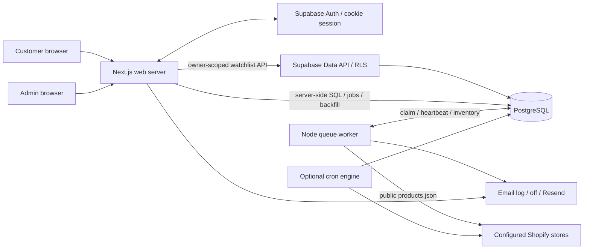
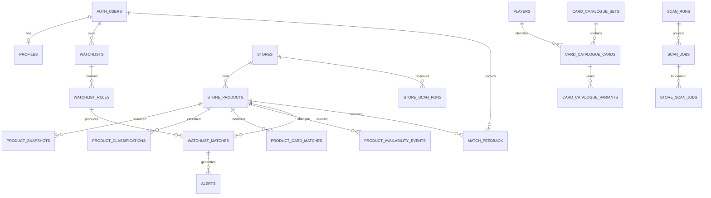

# CardAlarm implemented system architecture

Source snapshot: `09f44f230324467007bc70dbc61571b579386fd9`, reviewed 2026-10-03. Main baseline: `66bd0c3`. This is a source-grounded description of the reliability draft, not a report of production state. [Build and runtime inventory](build-runtime-inventory.md) contains detailed manifests, commands, configuration, dependency versions, and verification evidence.

## Navigation

- [System shape](#system-shape)
- [Frontend, routes, and roles](#frontend-routes-and-roles)
- [Authentication and access boundaries](#authentication-and-access-boundaries)
- [Data model and migrations](#data-model-and-migrations)
- [Admin scan to cached inventory](#admin-scan-to-cached-inventory)
- [Classification and identity matching](#classification-and-identity-matching)
- [User watchlist to dashboard](#user-watchlist-to-dashboard)
- [Availability and history](#availability-and-history)
- [Email alerts](#email-alerts)
- [Administration and observability](#administration-and-observability)
- [Integrations and deployment](#integrations-and-deployment)
- [Legacy and planned boundaries](#legacy-and-planned-boundaries)
- [Verification and review priorities](#verification-and-review-priorities)

## System shape

CardAlarm caches Shopify storefront inventory, derives deterministic basketball-card signals, evaluates each user's watchlist against that cache, and displays available matching products with save/dismiss feedback and optional email alerts. The current application has Supabase Auth and PostgreSQL runtime access; earlier descriptions of a single-user SQLite-only tool are historical.

The Next.js web server and Node scanner are separate processes sharing PostgreSQL. The web server validates identity with a cookie-aware Supabase client, uses that client for owner-scoped watchlist writes, and uses `pg` for inventory, backfill, feedback, alerts, administrative writes, and queue enqueueing. The scanner uses `pg` directly. Browser code receives rendered results and submits actions; it does not receive the database connection string.



Sources: [web auth](../../web/src/lib/auth.ts#L11), [web SQL pool](../../web/src/lib/db.ts#L104), [worker](../../engine/src/worker.ts#L75), [ingestion](../../engine/src/ingest.ts#L458), [watchlist actions](../../web/src/lib/watchlist-actions.ts#L38). A second scheduler entrypoint exists in [engine/src/index.ts:36](../../engine/src/index.ts#L36); it does not enqueue jobs.

## Frontend, routes, and roles

The application uses App Router pages with server-side data loading, reusable listing/filter components, and server actions. Layout navigation is role-sensitive. The customer dashboard is a personalized feed, while the admin inventory route exposes the wider cached inventory. Listing cards link to the source storefront rather than providing checkout or purchase automation.

| Route | Implemented purpose and access |
| --- | --- |
| `/` | Public marketing/entry page; links change when signed in. |
| `/login`, `/signup` | Supabase password login/signup forms. |
| `/auth/callback`, `/auth/confirm` | Session exchange and email-confirmation handlers. |
| `/dashboard` | Requires a user; user's active watchlist matches, statistics, facets, watchlist chips, cached-match refresh. Legacy inventory view query redirects admins to `/admin/inventory`. |
| `/watchlists`, `/watchlists/new`, `/watchlists/[id]` | Requires a user; owner-scoped list, create, edit, activate/deactivate, delete, notification toggle, and backfill. |
| `/saved` | Requires a user in the page; current available watchlist products whose latest save state is saved. |
| `/admin` | Requires admin; links to store, scan, inventory, QA operations. |
| `/admin/stores`, `/admin/stores/new`, `/admin/stores/[id]/edit` | Requires admin; manage store configuration and active state. |
| `/admin/scans` | Requires admin; enqueue a scan, inspect latest/recent global and store run projections. |
| `/admin/inventory` | Requires admin; paginated active available inventory with classification/match filters. |
| `/admin/scan-qa` | Admin guard in `getAdminScanQaData`; current job/run summary, store progress, match evidence and filters. |
| `/api/scan-status` | Authenticated admin only, explicit 401/403 responses; returns latest global scan projection and expires old running projections. |

Route anchors: [dashboard:23](../../web/src/app/dashboard/page.tsx#L23), [saved:9](../../web/src/app/saved/page.tsx#L9), [admin:7](../../web/src/app/admin/page.tsx#L7), [QA guard:391](../../web/src/lib/admin-scan-qa.ts#L391), [status:12](../../web/src/app/api/scan-status/route.ts#L12), [layout:38](../../web/src/app/layout.tsx#L38). `proxy.ts:4` names `/search` and `/settings` as protected paths, but no pages for them exist in this snapshot. `/saved` is not in that proxy list; its page-level guard is therefore significant.

## Authentication and access boundaries

`web/src/proxy.ts:16` creates an SSR Supabase client, refreshes cookies, checks claims, redirects unauthenticated protected requests, and reads `profiles.role` for admin paths. If public Supabase configuration is missing, the proxy passes through; server page/action guards still call Auth. `auth.ts:11` uses `getUser()` rather than accepting a client-supplied user ID. `requireUser()` ensures a profile exists; `requireAdmin()` reads the database profile and redirects non-admins. Default application profile creation writes `role='user'`.

There are two distinct authorization paths:

1. **Supabase Data API:** watchlist CRUD runs under the user's cookie session. Owner RLS policies check `auth.uid()`, and rule policies join the owning watchlist. Match/feedback/alert policies also scope owner data. Catalogue/inventory classifications have authenticated read policies. Queue tables enable RLS without customer policies.
2. **Direct SQL:** web `pg` queries and scanner pools do not establish the user's JWT database context or `SET ROLE` in the code. Protection therefore depends on the deployment database role and application checks. For example, backfill selects rules using both `watchlistId` and authenticated `userId`; feedback verifies ownership of an active available matched product before inserting a user-specific event; store actions and scan enqueue actions require admin. RLS on a table does not by itself prove that these pooled connections enforce customer isolation.

Sources: [proxy:16](../../web/src/proxy.ts#L16), [auth:57](../../web/src/lib/auth.ts#L57), [feedback validation:28](../../web/src/lib/actions.ts#L28), [backfill owner query:14](../../web/src/lib/watchlist-backfill.ts#L14), [store admin checks:27](../../web/src/lib/store-actions.ts#L27), [RLS hardening:54](../../supabase/migrations/20260507001000_harden_cardalarm_rls_and_indexes.sql#L54), [policy consolidation:13](../../supabase/migrations/20260513005000_consolidate_user_owned_rls_policies.sql#L13).

**Role-integrity review is unresolved:** repository profile INSERT/UPDATE policies constrain `user_id`, but do not constrain `role`. The schema allows `user` and `admin`, and the visible trigger is an updated-at trigger, not a role-write guard. Application forms only create normal users, but that does not establish protection against a direct authenticated Data API request. A reviewer must verify deployed column grants, triggers and policies; source alone does not show protection against self-promotion. Evidence: [initial profiles:13](../../supabase/migrations/20260507000000_initial_schema.sql#L13), [owner UPDATE:55](../../supabase/migrations/20260507001000_harden_cardalarm_rls_and_indexes.sql#L55), [owner INSERT:2](../../supabase/migrations/20260507002000_allow_profile_self_insert.sql#L2).

The published key is used for Auth/Data API; server SQL needs a private connection string. There is no app-side service-role browser client. Neither actual deployed database privilege grants nor session revocation behavior was tested.

## Data model and migrations

The database is layered: storefront observations, deterministic classification/identity, per-user intent and results, delivery/feedback, and scan control. `source + external product ID` is the recurring cross-layer identity. `store_products.id` anchors canonical inventory relationships; `source_products` preserves cache state and evaluation hashes.



This diagram is conceptual; nullable FKs, delete behavior, uniqueness and exact column definitions belong to the migrations. `source_products` and legacy `listings_feed` bridge to canonical products through source/external ID as well as newer product references. Current per-store runs are not populated through the per-store queue foundation.

| Layer | Tables and current responsibilities |
| --- | --- |
| Identity | `profiles` keyed by Auth user; role and display name. |
| Stores | `stores` URL/source type/active state/scan configuration and last success/failure; `store_scan_runs` operational counters, phase/timing metadata and errors. |
| Observations | `source_products` raw payload, content hash, availability, last scan token and evaluated hash/context; `store_products` current price/availability/URLs/title and fingerprint; `product_snapshots` changed observations. |
| Classification | `product_classifications` deterministic parsed signals, classifier type/version, category, confidence and raw evidence. |
| Identity resolution | `product_card_matches` versioned direct/stealth matching, confidence, reasons, reviewed fields, optional catalogue/player links; `reference_checklists` imported flat set/card/player reference. |
| Catalogue | `players`, `player_aliases`, `teams`, `card_catalogue_sets`, `card_catalogue_cards`, `card_catalogue_variants`; stage-one selector foundation. |
| User intent/results | `watchlists`, `watchlist_rules`, `watchlist_matches`; rule/result references plus source identity; `match_feedback` append-only user actions. |
| Events/delivery | `product_availability_events` deduped scanner events; `alerts` deduped email work/status/attempts/provider result. |
| Control | `scan_runs` UI projection, `scan_jobs` worker ownership/retries/heartbeat; `store_scan_jobs` future per-store queue. |
| Retained compatibility | Singular `watchlist`, `listings_feed`, `admin_audit_log`; schema presence does not imply an active UI or complete audit trail. |

Initial definitions start at [initial schema:13](../../supabase/migrations/20260507000000_initial_schema.sql#L13); watchlists at [212](../../supabase/migrations/20260507000000_initial_schema.sql#L212), product matches at [281](../../supabase/migrations/20260507000000_initial_schema.sql#L281), feedback at [320](../../supabase/migrations/20260507000000_initial_schema.sql#L320). Later migrations add scan configuration/counts, reconciliation of historical schema, availability events, alerts and alert processing status, RLS/index hardening, queue schema, rookie identity cleanup, catalogue intent fields, and reference-to-catalogue backfill.

**Migration completeness limitation:** `product_classifications` is read and written by the current runtime, but no checked-in migration creates it. [20260513003000:25](../../supabase/migrations/20260513003000_product_classifications_rls.sql#L25) explicitly says it exists remotely and conditionally adds RLS. A clean database migration replay can succeed while leaving a required runtime table absent. Its exact deployed DDL must be recovered/verified before claiming reproducible deployment. Runtime use is visible at [engine db:410](../../engine/src/db.ts#L410) and [inventory joins](../../web/src/lib/inventory-sql.ts).

Catalogue backfill [20260525001000:23](../../supabase/migrations/20260525001000_backfill_catalogue_from_reference_checklists.sql#L23) normalizes reference player/set/card identities into NBA catalogue records, assuming the source checklist content is appropriate. It is a one-time data migration, not a general recurring checklist import API.

## Admin scan to cached inventory

```mermaid
sequenceDiagram
  actor A as Admin
  participant W as Web action
  participant D as PostgreSQL
  participant Q as Node worker
  participant S as Shopify storefront
  A->>W: Start scan (watchlist/full)
  W->>W: requireAdmin + validate mode
  W->>D: Check active work / expire stale work
  W->>D: Transaction: queued scan_run + scan_job
  Q->>D: Recover stale jobs; atomic SKIP LOCKED claim
  Q->>D: Projection running + heartbeat
  Q->>D: Load active Shopify stores
  loop bounded concurrent stores / page batches
    Q->>S: GET products.json
    S-->>Q: products / failure
    Q->>D: Cache + canonical inventory + classifications + events + snapshots
    Q->>D: Per-store counters and phase metadata
  end
  Q->>D: Reconcile active user watchlists
  Q->>D: Queue and claim email alerts
  Q->>D: Complete/fail job + projection
  A->>W: Poll scan status / open QA
  W->>D: Read latest projection and evidence
```

1. `startScan` [actions.ts:102](../../web/src/lib/actions.ts#L102) requires admin, accepts `watchlist`/`full`, checks active queue/projection rows, then delegates enqueueing. `enqueueScanJob` [scan-jobs.ts:69](../../web/src/lib/scan-jobs.ts#L69) inserts a queued `scan_runs` projection and `scan_jobs` row in one transaction. The web does not spawn the scanner.
2. `runWorkerOnce` [worker.ts:75](../../engine/src/worker.ts#L75) recovers stale global/store jobs, claims one due global job using `FOR UPDATE SKIP LOCKED`, marks its projection running, loads sources, and runs ingestion with a progress callback. Heartbeats normally run every ten seconds. One-shot mode exits after one job; loop mode polls when idle.
3. [sources.ts:101](../../engine/src/sources.ts#L101) loads active stores, normalizes supported Shopify configuration and sorts sources. `sources.json` fallback is explicit opt-in; unsupported source types are not scanned. Store frequency metadata is persisted but the active worker does not choose only due stores.
4. [ingest.ts:194](../../engine/src/ingest.ts#L194) fetches `/products.json?limit=...&page=...`, with a fetch timeout and bot headers. Stores default to concurrency two (bounded 1–4), page batches default to one (bounded 1–5). Random delays separate page batches and the end of store work. It uses **the first variant's** price and availability and **the first image**; no variant-level product model or currency conversion occurs.
5. Product hash uses ID, title, handle, first-variant price/availability, first image and HTML description; raw payload is also retained. `upsertSourceProducts` [db.ts:263](../../engine/src/db.ts#L263) deduplicates batch source IDs, reads old cache hashes, then transactionally upserts raw cache, canonical product, deterministic classifications, change events, and changed-only snapshots using JSON recordset SQL.
6. `shouldMatch` describes whether an available cache row needs identity evaluation because it is new, changed, or its evaluation hash/context is stale. The current source loop **counts and records those rows but does not invoke the legacy identity matcher**. It marks evaluated hash/context after the store, then reconciles watchlist SQL across cached products after all stores settle. Classifications are built during every cached page's persistence for available products, including unchanged ones.
7. Incremental stores may stop after consecutive unchanged full pages. Ingestion only performs missing-product OOS reconciliation when neither a fetch error nor cache early stop occurred. Store metadata records pages, stop reason, phase and timings.
8. Store failures settle independently and aggregate after all store work; some stores may persist successful data even if the overall job fails. A fetch error with zero fetched products throws; an error after earlier successful pages can return a completed store with `stopReason='fetch_error'`, while suppressing missing-product OOS. Watchlist/alert reconciliation errors are logged and swallowed by ingestion, so a job may finish successfully despite failure of that downstream phase.

The selected `watchlist` versus `full` job mode currently changes labels/validation, not the source inventory traversal or matcher scope: source-specific `scanStrategy` controls early stop. `matched` is the reconciliation SQL row count (created or updated rows), not necessarily newly discovered cards. Per-store `matched` remains zero in this source loop. Aggregate progress is published after a store settles and after reconciliation, while detailed per-store phases update during page processing. See [ingest.ts:359](../../engine/src/ingest.ts#L359), [391](../../engine/src/ingest.ts#L391), [497](../../engine/src/ingest.ts#L497), [566](../../engine/src/ingest.ts#L566).

Queue behavior is narrower than its schema: claims are atomic; explicit execution failures become `failed` rather than automatically requeued; heartbeat expiry requeues attempts below `max_attempts` with a one-minute delay, otherwise marks `timed_out`. Cancellation fields/helper exist but the worker does not consume them. Store job claim/heartbeat/recovery helpers exist, but this worker does not populate or execute `store_scan_jobs`. `shallow` is allowed in queue DDL but rejected by `jobMode`. See [scan-jobs.ts:45](../../engine/src/scan-jobs.ts#L45), [146](../../engine/src/scan-jobs.ts#L146), [215](../../engine/src/scan-jobs.ts#L215), [257](../../engine/src/scan-jobs.ts#L257), [worker.ts:39](../../engine/src/worker.ts#L39).

## Classification and identity matching

Current runtime classification is deterministic title parsing, not an AI enrichment service. [parse-title.ts:183](../../engine/src/parse-title.ts#L183) recognizes product-line, parallel, insert, variation, case-hit and short-print signals; [309](../../engine/src/parse-title.ts#L309) derives season/set/card/player, serial, autograph and rookie metadata. [product-classification.ts:248](../../engine/src/product-classification.ts#L248) only generates rows for available products, rejects non-card and non-NBA sport signals, optionally applies a known card-heavy source boost, derives category `NBA` or null, and stores raw evidence. `team_name` is currently null. Classifier type/version is `deterministic` / `deterministic-title-v1`; confidence is a bounded heuristic based on recognized fields, not empirically calibrated probability.

Classification is distinct from `product_card_matches`. An NBA classification may drive watchlist matches even without a `product_card_matches` row. Inventory views select the preferred current deterministic classifier version, falling back to the newest available deterministic row, and the best identity match by confidence/update time. Classification-only rows appear as `Cached`; rows with an identity match appear as `Matched`.

The older Postgres matcher remains in [match.ts:202](../../engine/src/match.ts#L202): direct watchlist player title matching scores 0.94 with a card number or 0.88 without; stealth number targets score 0.80, set+number checklist matches 0.86, unique broad checklist-player resolution 0.76. It rejects non-card/non-NBA context and avoids assigning stealth identity when a title already names another player. `ChecklistLookupCache` [match.ts:82](../../engine/src/match.ts#L82) caches normalized checklist numbers and negative lookups. Matches persist legacy feed plus versioned identity records through [db.ts:853](../../engine/src/db.ts#L853). These mechanisms are retained capabilities, **not the current ingestion hot path**. SQLite matcher copies underlie some tests and historical tools.

## User watchlist to dashboard

```mermaid
sequenceDiagram
  actor U as User
  participant W as Web action
  participant API as Supabase owner API
  participant D as PostgreSQL cache
  U->>W: Create/update/activate/refresh watchlist
  W->>W: requireUser + validate form + ownership
  W->>API: Persist watchlist and rule
  W->>D: Transaction: owner rules; delete old results; recompute from cache
  W->>D: Enqueue alerts / process pending batch
  W-->>U: Revalidate dashboard/watchlists
  U->>W: Open dashboard / filter / save / dismiss
  W->>D: User-owned active available matches + latest feedback state
  W-->>U: Personalized listings and facets
```

Forms support player/team/set/card/variant catalogue selections, brand/product line/season/card number/parallel, rookie/auto/relic/serial/graded/raw flags, price bounds, currency, include/exclude text, notification state and minimum confidence. Form parsing normalizes optional values, validates ID syntax, and rejects inverted price bounds. It does not validate relationships between catalogue selections or reject simultaneous graded-only and raw-only flags. `intent_type` records `custom`, `player`, `team`, `set`, `card`, or `variant`; it is chosen from selected IDs. Sources: [watchlist-form.ts:96](../../web/src/lib/watchlist-form.ts#L96), [111](../../web/src/lib/watchlist-form.ts#L111), [catalogue-options.ts:106](../../web/src/lib/catalogue-options.ts#L106), [watchlist-actions.ts:38](../../web/src/lib/watchlist-actions.ts#L38).

The action writes watchlist and rule through separate Data API requests, then calls direct-SQL backfill and alerts. Those steps are not a single transaction: a later rule/backfill/email error can leave earlier intent writes committed. Name becomes include text when include text is absent, except a generic rookie name paired with rookie-only intent.

Customer mutations never fetch storefronts. `backfillWatchlist` [watchlist-backfill.ts:38](../../web/src/lib/watchlist-backfill.ts#L38) transactionally selects owned active rules, deletes that watchlist's prior matches, and recreates matches from canonical active available products classified NBA. A positive filter is required; price/exclusion-only criteria do not count as positive intent. Included comma/newline terms are ANDed; exclusions reject any matching term. Generic `rookie`/`rookies`/`rc` is a rookie signal predicate rather than arbitrary broad text. Matching uses classification, title/description and optional identity evidence.

Global scanner reconciliation [watchlist-reconciliation.ts:5](../../engine/src/watchlist-reconciliation.ts#L5) similarly evaluates all active owners' rules but only upserts qualifying results; it does not delete older rows that no longer qualify. Customer backfill rebuilds results. Those two implementations can diverge: scanner graded/raw logic recognizes PSA/BGS as well as `graded`; web backfill uses text `graded`. Scanner card-number logic includes parsed classification number; web backfill uses title/description number forms. Currency is stored but is not a matching predicate or conversion operation.

**Catalogue stage-one limitation:** `team_id`, `set_id`, `catalogue_card_id`, `catalogue_variant_id`, and `intent_type` are persisted and offered in the form, but neither reconciliation SQL uses them directly. Player ID is used; brand/product-line/season/card-number/parallel/text fields are used. Selecting a catalogue item is not proof of exact canonical identity matching. The migration explicitly records that matching is unchanged: [20260525000000:25](../../supabase/migrations/20260525000000_stage1_catalogue_watchlist_foundation.sql#L25). This is an implemented intent foundation, with later catalogue matching still planned.

**Confidence semantics:** both matching SQLs use `greatest(identity confidence, rule minimum confidence)` as the output score. They do not filter low-confidence identity by a minimum threshold; a rule value can raise a result's displayed confidence. `possible` identity status remains possible, otherwise scores at least 0.75 become current. Reviewer should assess intended semantics. See [watchlist-backfill-sql.ts:167](../../web/src/lib/watchlist-backfill-sql.ts#L167) and [watchlist-reconciliation.ts:28](../../engine/src/watchlist-reconciliation.ts#L28).

Dashboard queries require owner ID, active watchlist, active available canonical product; deduplicate across matching rules/watchlists by product ID; rank by strongest match; and hide dismissed/not-match feedback. Saved cards use latest save/unsave state but remain scoped to current active available watchlist matches, so this is not a permanent collection archive. Feedback is per-user append-only, not a global product dismissal, and does not retrain a classifier. Sources: [queries.ts:50](../../web/src/lib/queries.ts#L50), [244](../../web/src/lib/queries.ts#L244), [inventory-sql.ts:5](../../web/src/lib/inventory-sql.ts#L5), [actions.ts:62](../../web/src/lib/actions.ts#L62).

## Availability and history

Ingestion updates observed availability and records one highest-priority change event per changed product per scan token: `first_seen`, `restocked`, `sold_out`, `price_changed`, then `product_updated`. It records before/after values, fingerprints, source and reason metadata; dedupe uses event type/product/token. Because this is a priority case expression, simultaneous price and stock changes do not produce every possible event. Changed cache hashes produce snapshots; unchanged rows refresh current/cache timestamps without new snapshots. See [db.ts:451](../../engine/src/db.ts#L451), [524](../../engine/src/db.ts#L524), [event migration:1](../../supabase/migrations/20260513001000_product_availability_events.sql#L1).

A complete scan marks missing cached products unavailable and canonical products inactive, adds sold-out events, and updates legacy feed OOS. Early stopping and fetch error suppress this operation. The missing-product helper's reported count comes from the legacy `listings_feed` update, so it can understate canonical availability changes if legacy feed rows are absent: [db.ts:664](../../engine/src/db.ts#L664).

The separate OOS watchdog [availability.ts:119](../../engine/src/availability.ts#L119) fetches a complete inventory at page size 250, validates product IDs/variant booleans, and only reconciles when all fetches are complete. It uses first-variant available IDs; `reconcileSourceAvailability` [db.ts:751](../../engine/src/db.ts#L751) updates all cached and canonical availability/active state, and marks unavailable legacy feed rows OOS. It does not write availability events or snapshots, does not refresh product prices/title/classification, and does not run watchlist or alert reconciliation. A restored canonical product can become active even though its legacy OOS flag remains set.

Customer and admin current feeds read canonical availability rather than treating legacy OOS/feed membership as truth. Failed or incomplete remote fetches must not be interpreted as a complete inventory disappearance; watchdog validation covers this more explicitly than the ingestion response parser, which currently trusts a cast and defaults missing `products` to an empty array.

## Email alerts

Alerts run in both web mutations and ingestion. Implementations are duplicated in [web alerts:86](../../web/src/lib/alerts.ts#L86) and [engine alerts:89](../../engine/src/alerts.ts#L89). Each candidate links owner/watchlist/product/current match, looks up recipient from `auth.users`, and snapshots title/price/source/URL/match confidence/reasons.

- Dedupe is `new_watchlist_match:email:userId:watchlistId:storeProductId`. Multiple rules for one watchlist/product do not intentionally yield separate emails. Restock/price-change events do not create their own alert type; availability events are not the delivery trigger.
- Notification-disabled candidates become `suppressed`; enabling notification can promote suppressed rows to pending and refresh their payload. A sent record is not reset by ordinary subsequent scans/backfills.
- Claims use an atomic `FOR UPDATE SKIP LOCKED` update to `processing`, increment attempts, then send serially. Defaults: batch 25, max attempts 3, failed retry after 15 minutes; processing rows older than 15 minutes are released to failed.
- Default `log` records an email to process logs and marks the alert sent; `off` also returns success and marks it sent without delivery; `resend` POSTs plain-text mail using private API key and configured sender. `sent` therefore means the selected mode completed, not necessarily that a real email arrived.
- Web `enqueueAndProcessWatchlistAlerts` scopes enqueueing to the changed watchlist but calls a global pending-alert processor. Engine processing happens after reconciliation; there is no independent alert-draining service in the inspected entrypoints.

Evidence: [engine dedupe:47](../../engine/src/alerts.ts#L47), [enqueue:135](../../engine/src/alerts.ts#L135), [claim:221](../../engine/src/alerts.ts#L221), [processing:249](../../engine/src/alerts.ts#L249), [web dispatch:287](../../web/src/lib/alerts.ts#L287). Delivery and final database status are separate operations; a crash after external acceptance can cause a retry, and no provider idempotency header is shown. Notification changes after queueing do not revalidate recipient/watchlist eligibility in the claim/send path. Delivery latency and exactly-once behavior require integration review.

## Administration and observability

Store actions validate Shopify-only source type, HTTP(S) URL, slug, scan strategy, early-stop bounds and frequency range; they persist configuration through server SQL. Active state determines source loading. There is no implemented generic scraper, marketplace adapter, public store submission workflow or storefront admin API integration. URLs are admin-controlled; the parser does not implement an outbound destination allowlist. See [store-form.ts:37](../../web/src/lib/store-form.ts#L37), [store-actions.ts:27](../../web/src/lib/store-actions.ts#L27), [sources.ts:60](../../engine/src/sources.ts#L60).

`scan_runs` is a compatibility/UI projection; `scan_jobs` is queue ownership. `/api/scan-status` is a mutating GET: it fails running projections older than 30 minutes before returning the latest one. Enqueue-time stale cleanup also acts on projections. Worker heartbeats update jobs rather than the projection's starting timestamp, so a healthy long scan can appear failed in UI and later be overwritten complete. Claim/completion/projection updates are separate statements, and projection completion is not conditioned on successful ownership update. This is a review target for lease/projection consistency, not a verified production incident.

Per-store runs record phases (`fetching`, `caching`, `matching`, post-scan steps, completed/failed), seen/processed/matched/unavailable counts and durations. QA joins recent jobs/projections and finds store runs/matches by a time window rather than a complete durable parent linkage. This supports diagnosis but is not exact per-job causality under overlapping entrypoints. Sources: [QA summary:159](../../web/src/lib/admin-scan-qa.ts#L159), [store progress:206](../../web/src/lib/admin-scan-qa.ts#L206), [match window:240](../../web/src/lib/admin-scan-qa.ts#L240), [status mutation:19](../../web/src/app/api/scan-status/route.ts#L19), [job completion:109](../../engine/src/scan-jobs.ts#L109).

Optional SQL timing logs include sanitized target, operation, query fingerprint, duration, row count and success; parameters are not emitted by that logger. Scanner logs include store/page URL and counters; default email logging includes recipient and message text. `admin_audit_log` exists in schema but current store/scan/feedback paths do not establish a complete admin audit trail. No production metrics backend, distributed trace system or alert dashboard is wired in inspected code.

## Integrations and deployment

Implemented boundaries are Supabase Auth/Data API, PostgreSQL via `pg`, public Shopify JSON endpoints, optional Resend, Google Fonts during Next build, and legacy spreadsheet-to-SQLite seed/import tooling. There is no Shopify OAuth, Admin/Storefront GraphQL client, webhook subscription, live marketplace search, transaction handling, payment integration or AI model call in the current scan path.

The [staging runbook](../staging-deployment-runbook.md) recommends a hosted Next server, hosted Supabase, and separate always-on polling or periodically invoked one-shot worker. This is operational guidance, not proof that any host currently runs them. The direct cron engine starts ingestion immediately and schedules it every 15 minutes; its watchdog runs at minute 7/37. Those timers bypass `scan_jobs`, and no in-process mutex prevents a long cycle overlapping the next schedule. Running cron engine plus queue worker can create concurrent cache writers and competing scan tokens. One-shot `scan.ts` also bypasses the queue and still contains an outdated child-process comment; current web enqueueing does not use it.

`stores.scan_frequency_minutes` is configurable but not consumed as a per-store due-time scheduler in the current queue worker or cron engine. Root and web database pools are independently configured. TLS verification is enabled by default but can be explicitly disabled; actual network role/grants, pool limits, timezone, platform concurrency and connection budgets are deployment facts not established here. Detailed environment and build configuration is in [inventory](build-runtime-inventory.md).

## Legacy and planned boundaries

| Present source/schema | Current status |
| --- | --- |
| Supabase/Postgres runtime | Used by both web and active scanner. Earlier SQLite-only instructions in `docs/agent.md` are historical product/stack direction. |
| `engine/src/sqlite-test-db.ts`, `sqlite-match.ts` | Compatibility fixtures/legacy matcher behavior used by tests; not production `getDb`. |
| `seed.js`, checklist `.xlsx` files, `backfill-metadata.ts`, `killscan.js` | SQLite-specific historical tooling. `killscan.js` changes local SQLite scan state and does not control current Postgres worker jobs. |
| `scripts/migrate-sqlite-to-supabase.js` | Explicit legacy import bridge, not normal ingestion. No invocation was performed. |
| `replay-backup.ts` | Deprecated stub directing users to the migration script. |
| Singular `watchlist`, `listings_feed`, legacy matcher | Retained compatibility and test/import paths; current customer feed derives from canonical inventory and user watchlist matches. |
| `store_scan_jobs`, shallow strategy, cancel fields | Schema/helpers without complete worker execution wiring. |
| Catalogue-backed intent fields/options | Implemented stage-one persistence/selection; exact team/set/card/variant matching remains unwired. |
| Availability events | Persisted scanner history; restock/price alert routing remains unwired. |
| AI enrichment, per-store scheduling, distributed workers | Target/design possibilities, not implemented capabilities in this snapshot. |

Sources: [SQLite metadata tool](../../engine/src/backfill-metadata.ts#L8), [deprecated replay](../../engine/src/replay-backup.ts#L1), [legacy seed](../../seed.js#L3), [migration bridge](../../scripts/migrate-sqlite-to-supabase.js#L3), [queue DDL](../../supabase/migrations/20260513008000_scan_job_queue.sql#L29), [catalogue stage-one comments](../../supabase/migrations/20260525000000_stage1_catalogue_watchlist_foundation.sql#L25).

## Verification and review priorities

On the reviewed checkout, the parent review verified **33 Jest suites / 281 tests**, root and web TypeScript checks, web lint, and a production web build. The build required network access for Google Fonts; an initial restricted-network fetch failure was environmental. The build warned about multiple lockfiles/inferred workspace root. Detailed evidence and commands are recorded in [build-runtime-inventory.md](build-runtime-inventory.md). This document's author performed source tracing and documentation edits, not a second independent test run.

Tests cover parser/extractor/matcher examples, deterministic classification and rookie sanitization, cache batches/evaluated hashes/early stop, source loading, availability fetch failure safeguards, event persistence SQL, queue claim/recovery/worker projections, alert claims/dedupe, watchlist form/backfill/inventory SQL, server-action ownership guards, navigation boundaries, migration/index/RLS text assertions and QA query shapes. See [engine/__tests__](../../engine/__tests__). Many tests use SQLite fixtures, mocked PostgreSQL calls, or source/migration text checks; their passing results do not prove deployed PostgreSQL semantics, actual RLS privileges, cross-process race handling, remote fetch schema, browser cookie flows or real email delivery.

Architecture review should verify the following before treating this as a production-complete system:

1. **Reproducible schema:** recover `product_classifications` DDL, replay migrations against a clean database, confirm exact FK/index/default/trigger/grant state. No live database was queried.
2. **Role integrity and SQL authority:** verify users cannot alter their own profile role through the Data API; document and minimize web/worker database privileges; test two-user isolation for every direct-SQL path.
3. **Queue ownership and projection consistency:** assess enqueue check-versus-insert race (no unique active-job invariant shown), stale recovery versus healthy long scans, fencing after lease loss, cancellation, automatic failure retry policy, and interaction with direct cron/CLI entrypoints.
4. **Reconciliation correctness:** test global upsert-only stale result retention, parity with web backfill, catalogue IDs ignored by predicates, configured confidence raising rather than filtering, currency semantics and classifier fallback after version changes.
5. **Ingestion integrity:** validate malformed successful `products.json` responses before treating them as empty inventory, first-variant assumptions, snapshot growth, source-specific incremental ordering assumptions, transaction/concurrency correctness and count semantics.
6. **Alert delivery:** verify real sender/Auth email lookup access, retries after send/status crash, notification-off behavior for already pending work, global web batch processing and drain cadence; `log`/`off` sent states must not be mistaken for actual delivery.
7. **Hosted operations:** verify Auth redirects/cookies, worker persistence/restarts, migrations applied, pooling/connection budget, overlapping schedulers, monitoring/log privacy and empirical scan/backfill/feed latency at realistic cardinality.

These questions follow observed code boundaries and missing evidence. They do not assume live compromise, live schema drift or failed delivery. Historical runbooks and roadmap documents should be reconciled with these implemented limits before designing further stages.
